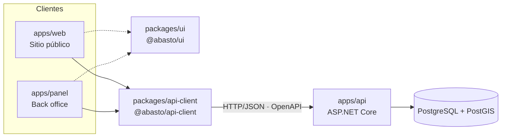

<h1 align="center">Abasto</h1>

<p align="center">
  <strong>Plataforma de disponibilidad de medicamentos con búsqueda geoespacial, gestión de inventario y trazabilidad de traslados entre farmacias.</strong>
</p>

<p align="center">
  
  
  
  
  
  
  
  
</p>

---

## Descripción

Abasto resuelve un problema concreto: la información sobre qué medicamentos hay en cada farmacia no está disponible de forma consultable, y las decisiones de reabastecimiento y traslado se toman sobre registros manuales. El sistema centraliza el inventario por farmacia y lo expone a través de una API única que consumen dos aplicaciones web:

- **Sitio público** para consultar disponibilidad por medicamento y cercanía.
- **Back office** con control de acceso basado en roles (RBAC) para operar inventario, traslados, parámetros y supervisión.

Proyecto desarrollado como trabajo de diploma en la Universidad de las Ciencias Informáticas (UCI).

## Alcance funcional

- Búsqueda de disponibilidad por medicamento y distancia a la farmacia, resuelta en base de datos con consultas geoespaciales (PostGIS).
- Inventario por farmacia en cantidad y monto total, con máximos y mínimos configurables y alertas de ruptura de stock.
- Traslados entre farmacias con flujo de solicitud, aprobación y registro.
- Gestión de catálogo de medicamentos, farmacias, usuarios y parámetros del sistema.
- Lectura de recetas a partir de una foto mediante un servicio OCR externo; el resultado es editable antes de ejecutar la búsqueda (planificado).

## Arquitectura



**Backend.** Arquitectura por capas (Clean Architecture) con la dependencia apuntando siempre hacia el dominio:

```
Api ──► Infrastructure ──► Application ──► Domain
```

| Capa                    | Responsabilidad                                          |
| ----------------------- | -------------------------------------------------------- |
| `Abasto.Domain`         | Entidades y reglas de negocio, sin dependencias externas |
| `Abasto.Application`    | Casos de uso, contratos (interfaces) y DTOs              |
| `Abasto.Infrastructure` | EF Core, PostgreSQL/PostGIS y servicios externos         |
| `Abasto.Api`            | Endpoints, configuración, OpenAPI/Swagger                |

**Frontend.** Dos aplicaciones Next.js (App Router) que comparten el sistema de diseño (`@abasto/ui`) y un cliente tipado generado a partir del OpenAPI de la API (`@abasto/api-client`), de modo que un cambio de contrato se detecta en compilación.

## Tecnologías

| Área                 | Tecnología                                                           |
| -------------------- | -------------------------------------------------------------------- |
| Backend              | C#, ASP.NET Core, Entity Framework Core                              |
| Base de datos        | PostgreSQL 16 con PostGIS                                            |
| Frontend             | Next.js, React, TypeScript, Tailwind CSS                             |
| Monorepo             | pnpm workspaces                                                      |
| Contenedores         | Docker Compose                                                       |
| Calidad              | Conventional Commits, Husky, lint-staged, commitlint, GitHub Actions |
| Documentación de API | OpenAPI / Swagger                                                    |

## Estructura del repositorio

```
abasto/
├── apps/
│   ├── api/            # Backend (C#, Clean Architecture)
│   ├── web/            # Sitio público (Next.js, puerto 3000)
│   └── panel/          # Back office (Next.js, puerto 3001)
├── packages/
│   ├── ui/             # Tokens de marca y componentes compartidos
│   └── api-client/     # Cliente tipado generado desde el OpenAPI
├── docs/               # Convenciones, arquitectura y decisiones técnicas
├── infra/              # Docker Compose y variables de entorno de ejemplo
└── .github/            # Workflows de CI y plantilla de Pull Request
```

## Requisitos

- [.NET SDK](https://dotnet.microsoft.com/download) (versión fijada en `global.json`)
- [Node.js](https://nodejs.org) (versión fijada en `.nvmrc`) y [pnpm](https://pnpm.io)
- [Docker](https://www.docker.com) con Docker Compose

## Primeros pasos

```bash
git clone https://github.com/<usuario>/Abasto.git
cd Abasto

cp infra/.env.example infra/.env     # define POSTGRES_USER, POSTGRES_PASSWORD y POSTGRES_DB
pnpm install
pnpm db:up                           # levanta PostgreSQL + PostGIS
pnpm dev                             # API + sitio público + back office
```

| Servicio      | URL de desarrollo                                        |
| ------------- | -------------------------------------------------------- |
| Sitio público | http://localhost:3000                                    |
| Back office   | http://localhost:3001                                    |
| API (Swagger) | `/swagger` en el puerto indicado en la consola de la API |
| Health check  | `/health`                                                |

> Los scripts y aplicaciones se incorporan de forma progresiva; el estado de cada pieza está en el apartado de hitos.

### Scripts de la raíz

| Script                        | Acción                                             |
| ----------------------------- | -------------------------------------------------- |
| `pnpm db:up` / `db:down`      | Inicia / detiene la base de datos                  |
| `pnpm db:reset`               | Elimina el volumen y recrea la base de datos       |
| `pnpm api`                    | Ejecuta la API con recarga en caliente             |
| `pnpm api:build` / `api:test` | Compila / ejecuta las pruebas del backend          |
| `pnpm web` / `pnpm panel`     | Ejecuta cada aplicación web por separado           |
| `pnpm dev`                    | Ejecuta API, sitio público y back office a la vez  |
| `pnpm web:dev`                | Corre el portal ciudadano en http://localhost:3000 |
| `pnpm web:build`              | Compila el portal para producción                  |

## Flujo de trabajo

- Dos ramas permanentes: `main` (estable y entregable) y `develop` (integración).
- Cada cambio llega por Pull Request con **un único commit** siguiendo [Conventional Commits](https://www.conventionalcommits.org/es/).
- `main` solo recibe cambios desde `develop`, y se etiqueta cada entrega con una versión semántica.

El detalle completo (ramas, commits, nombrado, revisión de código y pruebas) está en [`docs/convenciones.md`](docs/convenciones.md).
